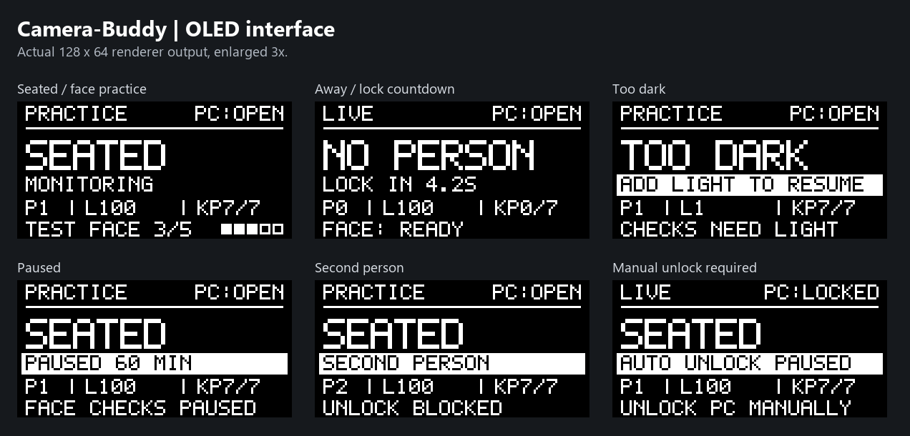

# Desk presence

Locks your Windows PC when you walk away from your desk, and unlocks it when it recognizes your face as you sit back down, using a Raspberry Pi 4B and the Raspberry Pi AI Camera.

The camera runs a body pose model on its own chip (it finds your head and shoulders about 30 times a second), so the Pi only receives the results and no pictures are ever stored. The Pi plugs into the PC's USB port and acts as an ordinary keyboard: when you leave, it presses **Windows + L**. Locking keeps every program running; nothing closes.

Face unlock is newer, and starts in practice too: see [Face unlock](#face-unlock).

## What's in here

| Folder | What it is |
|---|---|
| `pi/desk_presence/` | The program that runs on the Pi |
| `pi/setup/` | Install script, USB keyboard setup and start-at-boot services |
| `pi/config.example.toml` | All the settings, with explanations |
| `pc-helper/desk_helper.py` | A small program for the PC (pause hotkey, lock status, warnings, the PIN box for face unlock). Optional for locking, needed for unlocking |

## Safeguards against locking by mistake

- **You have to actually leave.** Standing up, stretching, leaning back or turning around never locks. Your body has to leave the camera's view and stay gone for 5 seconds (`away_seconds`).
- **No flicker locks.** A body has to be seen for half a second before it counts as back, and a single missed frame doesn't count as gone.
- **It has to have seen you first.** It only locks after it has seen you sitting there, so switching the Pi on in an empty room does nothing.
- **One lock per absence**, and nothing at all if the PC helper says the PC is already locked.
- **Too dark to judge means do nothing.** It won't lock you out while you're sitting in the dark.
- **A second person only causes a warning** (a beep on the PC) by default. You can change it to lock, or turn it off.
- **Pause switch:** **Ctrl + Alt + P** on the PC (with the helper running), or an optional button wired to the Pi, pauses everything for an hour. Press it again to resume. Unplugging the Pi also stops it instantly.
- **Practice mode is on by default.** It writes down what it *would* have done without pressing any keys. Run it like this for a week, read the log, tune the timings, then switch it off.

And if it does lock by mistake: it's just Windows + L. Type your PIN as usual.

## What you need

- Raspberry Pi 4B and the Raspberry Pi AI Camera
- A **USB-C power and data splitter** (best), so the Pi's own 5V/3A supply powers it and only the data line goes to the PC. Some PCs can power the Pi through a good USB-C cable instead, and `desk-check` tells you whether the power is steady. But if your mouse and keyboard stop working when you plug the Pi in, unplug it at once: that port or cable can't give it enough power. Powered by the PC, the Pi also switches off suddenly whenever the PC does, which now and then can damage what's on its SD card.
- A Windows PC. On the PC, set sleep to "Never" when plugged in (Settings, System, Power), because sleep pauses your programs and locking doesn't.

## Setting up the Pi

1. Install Raspberry Pi OS (Bookworm or newer) and connect the AI Camera.
2. Copy this repository onto the Pi, then from the `pi` folder run:

   ```
   sudo ./setup/install.sh
   sudo reboot
   ```

   This installs the camera software, turns on keyboard mode for the USB-C port, puts your settings in `~/desk-presence/config.toml` and starts the program at every boot.
3. Plug the splitter's power side into the Pi's own supply and its data side into the PC (or plug the Pi straight into the PC, see "What you need"). Windows should find a new keyboard and a new "USB Serial Device".
4. Check everything with one command (it presses nothing):

   ```
   desk-check
   ```

   It tells you on screen when to sit, stand up, walk away and come back, and beeps when it's time for the next step. Then it gives OK or PROBLEM for the power, for how the camera saw each of those, and for keyboard mode, with what to change. The results are saved in `~/desk-presence/checks/`. The first start of the camera uploads the model to it, which can take a minute.

   When the Pi is online, `desk-check` first installs the newest version of this program from GitHub, so after a fix you just run it again. To update without checking, run `sudo /opt/desk-presence/setup/update.sh`.

   To watch the camera's raw results instead, once a second: `sudo systemctl stop desk-presence`, then `cd /opt/desk-presence && python3 -m desk_presence camera-test`. Start the program again afterwards with `sudo systemctl start desk-presence`.

### No screen or keyboard on the Pi?

The Pi can do steps 1 and 2 by itself from the SD card:

1. Write **Raspberry Pi OS Lite (64-bit)** to the card with Raspberry Pi Imager. In its settings, set the name to `deskcam`, pick a username and password, enter your Wi-Fi, and turn on SSH (remote login).
2. Put the card back into your computer. Copy the `pi` folder onto the card's boot drive and rename the copy `desk-presence`.
3. Open `user-data` on the boot drive in a text editor and add these two lines at the end, with your username in place of `yourname`. If the file already has a `runcmd:` line, add only the second line at the end of its list, indented like the lines above it.

   ```
   runcmd:
   - [bash, /boot/firmware/desk-presence/setup/firstboot.sh, yourname]
   ```

4. Put the card in the Pi and switch it on. It waits for the Wi-Fi, updates itself, installs everything and restarts, which can take half an hour. It writes its progress to `desk-presence-setup.log` on the boot drive.
5. From the PC, log in with `ssh yourname@deskcam.local` and carry on from step 3.

## Optional OLED beneath the camera

See the [wiring diagram and pin-by-pin guide](docs/wiring.md) and the
[application flowchart and integration guide](docs/system-flow.md).

Camera-Buddy supports a **0.96-inch, 128x64 SSD1306 OLED with four I2C pins**.
Mount it just beneath the camera, facing you, without covering the lens or putting
strain on the camera ribbon. Keep the back of the display insulated from exposed
contacts. This is a monochrome text status screen; it does not show or store camera
pictures, faceprints, or your Windows PIN.

Switch the Pi off before wiring. Check the module's specifications confirm **3.3 V
power support**. Connect by the labels printed on the module: different boards put
the pins in different orders.

| OLED label | Raspberry Pi physical header pin | Function |
| --- | --- | --- |
| VCC / VDD | 1 | 3.3 V |
| GND | 6 | Ground |
| SDA | 3 | GPIO 2, I2C data |
| SCL / SCK | 5 | GPIO 3, I2C clock |

These are **physical pin numbers**, not BCM GPIO numbers. Reserve BCM 2 and 3 for
I2C; wire an optional pause button to another GPIO. Do not connect a module with
5 V signal pull-ups directly to the Pi's GPIO. See the
[Luma.OLED wiring reference](https://luma-oled.readthedocs.io/en/stable/hardware.html).

The installer/update installs the OLED software, enables I2C, and grants the
service account access. Reboot if requested. The display connects automatically,
including with an older configuration file that has no `[display]` section.
If it is absent or unplugged, the camera and locking continue; the display worker
retries every 30 seconds.

The fixed screen uses a large, left-aligned detection label, a quiet mode/PC
header, one message strip, aligned diagnostic columns, and a face-feedback footer.
Warnings and pause states use an inverted strip so they stand out without flashing.
The screen shows:

- A large **SEATED**, **STANDING**, **NO PERSON**, or **TOO DARK** label.
- **PRACTICE** or **LIVE**, and the PC helper's lock status (`?` means unknown).
- People counted after duplicate detections are merged, estimated lux (`?` if
  unavailable), and how many of the main person's seven head/shoulder points are
  visible. The compact columns are **P** (people), **L** (lux), and **KP** (visible
  keypoints out of seven). These are diagnostic measurements, not a recognition
  certainty score.
- Pause time, low-light/second-person warnings, or the remaining absence countdown
  when the lock policy is armed. Practice countdowns say **TEST LOCK IN**.
- Face-unlock checks, match progress, and results. The five-segment indicator
  shows progress through the required matching checks, not identity confidence.
  **TEST** / **WOULD UNLOCK** means
  face practice, even if presence locking is live. The minimum match duration
  still applies after the segment indicator fills. **FACE NOT READY** means no
  face is enrolled, models are missing, or a face check failed. **UNLOCK PC
  MANUALLY** means unlock Windows yourself before automatic unlock can resume.



Pause and current warnings take priority over brief action messages, which last
three seconds. **STARTING** appears during camera/model startup. **CAMERA WAIT**
replaces old detections after 15 seconds without processed frames; **CAM ERROR**
means camera processing failed. The display never changes the lock/unlock rules.

To change the screen, add this section at the end of
`~/desk-presence/config.toml` (or edit the existing section), then restart the
service with `sudo systemctl restart desk-presence`:

```toml
[display]
enabled = true
i2c_bus = 1
address = 0x3c # Set 0x3d if that is your module's address.
rotate = 0    # Set 180 for upside-down mounting.
```

Set `enabled = false` to disable display access. This does not disable the Pi's
I2C interface. The driver is for SSD1306; visually similar SH1106 modules are not
interchangeable with this configuration.

### Checking the OLED

`desk-check` shows the current detection, what to do next, and the step countdown
on the OLED as well as printing its usual report. `camera-test` also shows current
detections. These diagnostics press no keys; face recognition is not run during
these camera checks.

To check wiring, text, all four screen edges, and the configured rotation without
opening the camera or accessing the USB keyboard:

```sh
sudo systemctl stop desk-presence
cd /opt/desk-presence
python3 -m desk_presence --config ~/desk-presence/config.toml oled-test
sudo systemctl start desk-presence
```

The test runs for ten seconds and clears the screen. Restart the service even if
you interrupt the test. Stopping the service first prevents two programs writing
to the display simultaneously.

If the screen stays blank, check its pin labels and 3.3 V compatibility, reboot
after installation, and run `i2cdetect -y 1` with the service stopped. A typical
module appears at `3c`; use `address = 0x3d` if it appears at `3d`. Check that
`/dev/i2c-1` exists and `groups` includes `i2c`; log out and back in after adding
group membership for an interactive test. Installation already restarts the
service with its updated groups. Check `journalctl -u desk-presence -n 50` for
OLED connection errors. No address usually means wiring/power or I2C setup;
scrambled or shifted output can mean a different controller such as SH1106.
Mounting readability, orientation, and operation after unplugging the module
must be verified on the physical Pi/display.

## Setting up the PC helper (optional, recommended)

Locking works without it. The helper adds the Ctrl + Alt + P pause switch and the beeps, tells the Pi when the PC is already locked, and keeps the log that shows whether each practice "would have locked" was right.

1. If the PC has no Python yet, install it from python.org (Anaconda works too).
2. Copy the `pc-helper` folder somewhere on the PC.
3. Double-click `start-helper.cmd` in that folder. It finds Python, installs pyserial the first time, adds the helper to your Startup apps (so it runs without a window every time you log in) and starts it. It should end with "All set: it hears the Pi". After an update, double-click it again to restart the helper.

Its log is `helper.log` in the same folder: every message from the Pi, when the PC was locked and unlocked, how long before each lock you last used the keyboard or mouse, and each time you came back after more than 2 minutes away from them. Those last lines also say what the Pi's camera saw at the time (sitting, standing, nobody or too dark), and the log notes when the camera stops reporting.

To run it in a window instead: `py desk_helper.py`. To stop it and take it out of your Startup apps: `py desk_helper.py --uninstall` (or turn it off in Task Manager, under Startup apps).

## Practice week, then going live

Each day, check what it would have done. On the PC, `helper.log` lists each "would have locked now" with how long before it you last used the keyboard or mouse (a few seconds means you were still there) and what the camera saw in the minute before. On the Pi:

```
cd /opt/desk-presence && python3 -m desk_presence --config ~/desk-presence/config.toml log
```

Every `would_lock` line should match a time you really walked away. If it locked too eagerly, raise `away_seconds`. If it missed you leaving, check `camera-test` and the camera angle. When you're happy, set `practice_mode = false` in `~/desk-presence/config.toml` and run `sudo systemctl restart desk-presence`.

## Face unlock

When it locked the PC because you walked away, and you come back and sit down, the Pi looks at the camera's picture, and if it's you, it types your Windows PIN at the lock screen.

The pose model keeps running on the camera's chip. Only while the PC is locked and someone is sitting in your chair does the Pi look at the picture itself, with three small models (downloaded once and checked by `setup/get-models.sh`): a face finder (YuNet), a face describer that turns a face into 128 numbers (SFace), and a fake-face check that looks for paper texture and screen glare (MiniFAS, from [face-antispoof-onnx](https://github.com/suriAI/face-antispoof-onnx)). No pictures are saved: enrolling keeps only those numbers, in `~/desk-presence/face.npz`.

### Setting it up

1. Make sure your Windows sign-in uses a **PIN** (Settings, Accounts, Sign-in options), not just your Microsoft account password. A PIN only works on this one PC.
2. On the Pi, type `desk-face`. It walks you through looking at the screen, at the camera, turning your head and leaning back and in, then tests that it knows you. It presses nothing. Run `desk-face add` in other light (say in the evening), so it knows you then too.
3. Optional but worth it: `desk-face photo-test`, holding a photo of yourself up in front of your face. It should refuse it.
4. Update the PC helper (copy the new `pc-helper` folder over the old one and double-click `start-helper.cmd`). It needs Python's tkinter, which python.org's installer includes.

Face unlock then runs in practice: each time you come back after a "would have locked", the PC beeps twice and the log says whether it would have unlocked you, and how quickly (`would_unlock`), or that it didn't recognize you (`not_recognized`). It types nothing.

To switch it on for real, set `practice_mode = false` and, under `[unlock]`, `mode = "on"` in `~/desk-presence/config.toml`, then `sudo systemctl restart desk-presence`. The PC helper then pops up a box asking for your Windows PIN, which it hands to the Pi. **The Pi keeps your PIN in memory only**: not on its card, not in any log. When the Pi restarts or is unplugged, it's gone, and the helper asks again (or click "Not now", and it asks again in 8 hours).

### Safeguards

- **Only after the Pi itself locked the PC** because you walked away, and at most 4 hours ago (`max_hours`). After the Pi or the PC restarts, or the PC sleeps, you unlock by hand.
- **Only at the real Windows lock screen.** The helper tells the Pi when Windows says the session is locked, so the Pi never types into an admin ("allow changes?") prompt or a chat window. Without the helper, it never types.
- **Only once you're seated**, and only when your face matches on 5 looks in a row over at least 0.8 seconds. Never while a second person is in view.
- **The face has to fit your body:** it must be where the pose model puts your head, the right size for your shoulders, and about the size it was when you enrolled. A photo held up close fails this.
- **The fake-face check.** A matching face that looks like a photo or a screen 3 times turns auto-unlock off until you unlock by hand once, and the helper beeps a warning and logs it.
- **One PIN attempt per return.** If the PC is still locked afterwards (say you changed your PIN), the Pi clears what it typed, forgets the PIN, and stops until you unlock by hand once. So it can never be what locks you out of Windows.
- It looks for 30 seconds after you sit down (`give_up_seconds`), then waits for you to leave and come back. Too dark to judge, or paused (Ctrl + Alt + P), means it does nothing.
- A digits-only PIN is typed without Enter (Windows signs in by itself after the last digit). A PIN with letters gets Enter straight after. Letters assume an English keyboard layout.

Honest limits: this stops printed photos, phone and tablet screens and anyone at home trying a trick, but it isn't as strong as a Windows Hello infrared camera, and it won't stop a determined attacker with a realistic mask. Not built yet from the plan: the phone-in-view check, the LED ring challenge and the phone-nearby (Bluetooth) check.

Works on Raspberry Pi OS Bookworm (OpenCV 4.6, with the first YuNet face finder) and Trixie or newer (OpenCV 4.8+, with the newer one).

## Messages on the cable

The Pi and the helper only ever send these lines, and ignore anything else:

- PC to Pi: `LOCKED`, `LOCK_SCREEN` (the real lock screen) or `UNLOCKED` (every 2 seconds), `PAUSE` (toggle), and `PIN` followed by 4 to 20 letters and digits (only after the Pi asks, and only what you typed into the PIN box)
- Pi to PC: `PAUSED`, `RESUMED`, `WARN SECOND_PERSON`, `LOCKING`, `WOULD_LOCK`, `UNLOCKING`, `WOULD_UNLOCK`, `UNLOCK_FAILED`, `FACE_REFUSED`, `NOT_RECOGNIZED`, `NEED_PIN`, `PIN_OK`, and what the camera sees when it changes and once a minute: `CAMERA SEATED`, `CAMERA STOOD_UP`, `CAMERA AWAY`, `CAMERA TOO_DARK`

## Running the tests

```
pip install pytest numpy pillow pyserial
python -m pytest pi/tests pc-helper/tests
```

The tests don't need a Pi or a camera.

## Not done yet

- The rest of the anti-spoofing layers: phone-in-view check, LED ring challenge, phone nearby over Bluetooth
- Extras: pausing music when you leave, posture and break reminders, desk time report
