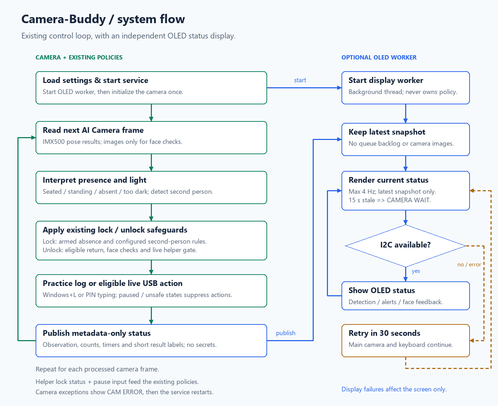
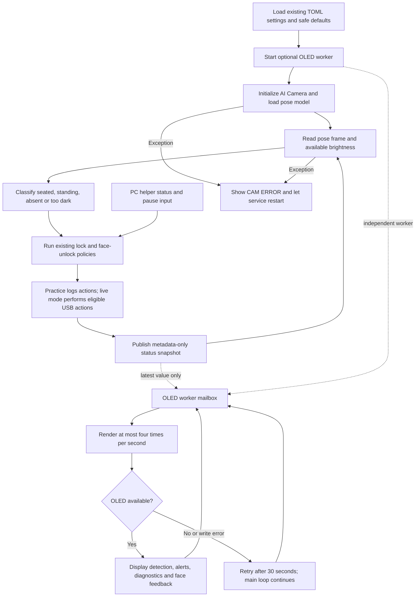

# Camera-Buddy system flow

The OLED observes the existing application. It does not decide when to lock or
unlock Windows. The camera stays on CSI, the OLED uses header I2C bus 1, and the
Windows helper continues using the existing USB serial protocol.



[Scalable flowchart](system-flow.svg) · [Wiring diagram](wiring.md)

## Control and display paths



The overview combines two existing policies; their actual conditions are:

- **Presence locking:** the policy must first become armed after a confirmed
  seated presence. Continued absence for `presence.away_seconds` (default 5 s)
  allows one lock per absence. Standing stays present. Pause and low light
  suppress actions; a PC already known to be locked is not locked again.
- **Second person:** a sufficiently large second body must remain for the
  configured duration (default 2 s). The default is a warning, with an optional
  lock action and a cooldown. A second person blocks face unlock.
- **Face unlock:** the policy needs an eligible previous Pi lock (or practice
  lock), a seated return, enrolled face/models, and successful face/body and
  anti-spoof checks. The default is five matching checks over at least 0.8 s.
  Live unlock additionally requires a fresh helper report of the real Windows
  lock screen and a PIN in memory. Face practice can simulate a return without
  that live lock-screen/PIN gate. Global practice mode always prevents typing.
- **Failure handling:** timeout/non-recognition waits for another return. Live
  refusal or an unsuccessful PIN attempt requires a manual unlock. The existing
  policy also expires old lock eligibility and handles helper silence.

## What crosses into the OLED worker

Only an immutable status snapshot crosses the display mailbox: observation,
people/keypoint counts, available lux, practice mode, PC status, policy countdowns,
pause time, and short action/face-result labels. Images, faceprints and PINs are
not included. Camera images are still requested only by the existing face flow.

The worker keeps the latest snapshot, not a backlog. It renders startup before
camera initialization, replaces detections with `CAMERA WAIT` after 15 seconds
without a processed frame, and marks stale PC status unknown. A missing library,
missing OLED, permission problem or I2C write error affects only that worker.
Orderly shutdown clears the display; a camera exception leaves its error visible
until the service restarts.

## Updating an existing Pi

The feature is published on `feat/ssd1306-status-display` in PR #4. To install that
branch before it is merged, use the project's existing branch-aware updater:

```sh
sudo /opt/desk-presence/setup/update.sh feat/ssd1306-status-display
sudo reboot
```

The installer preserves `~/desk-presence/config.toml`; older files without a
`[display]` section use the new display defaults. It installs the distribution
packages, enables header I2C, grants the service account I2C access, and restarts
the service. Rebooting applies any boot-interface changes.

After reconnecting, run `desk-check`, then use the standalone `oled-test` described
in the [wiring guide](wiring.md#check-the-wiring). Verify the screen is readable in
its final position and test both configured rotations as needed.

After the feature is merged, switch the updater back to `main` explicitly:

```sh
sudo /opt/desk-presence/setup/update.sh main
```

Physical Pi/OLED operation has not been verified in this development environment.
