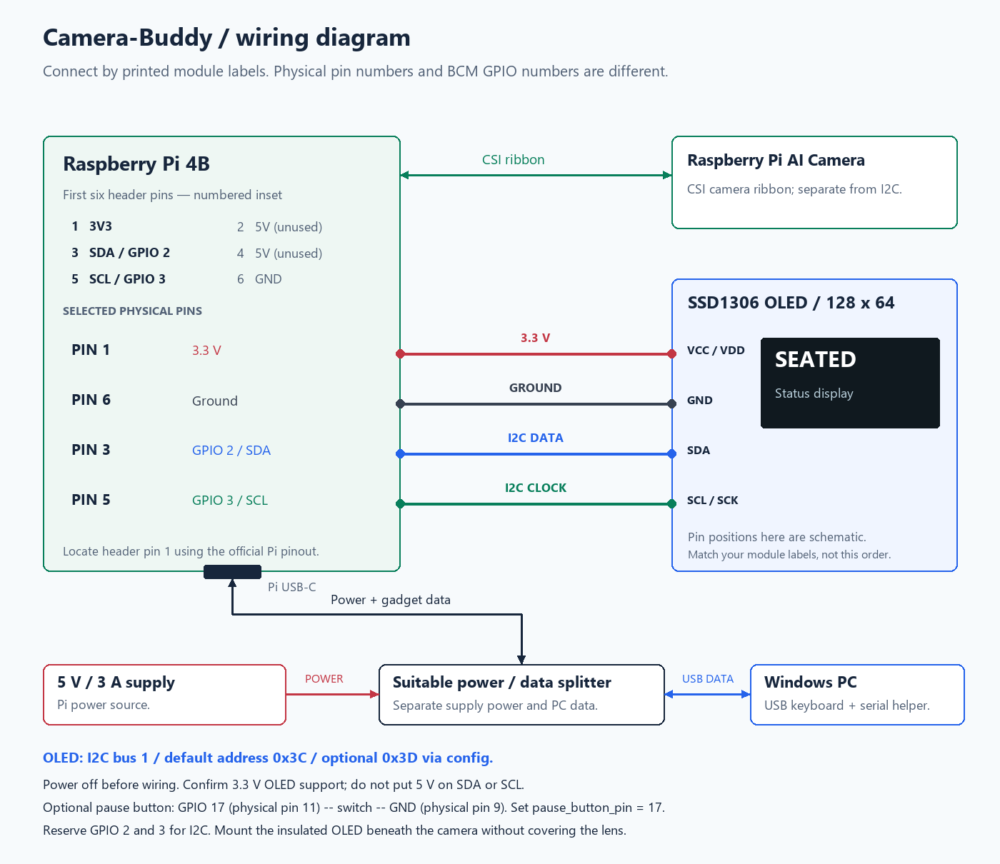

# Camera-Buddy wiring



[Scalable wiring diagram](wiring.svg) · [System flowchart](system-flow.md)

## OLED: four connections

Switch the Pi off before wiring. Confirm the OLED board supports **3.3 V power**.
Use the printed labels on the actual module: the drawing is a schematic, and
module pin order varies.

| OLED label | Pi physical pin | Pi signal | Diagram wire |
| --- | --- | --- | --- |
| VCC / VDD | **1** | **3.3 V** | Red |
| GND | **6** | Ground | Dark gray |
| SDA | **3** | GPIO **2**, I2C data | Blue |
| SCL / SCK | **5** | GPIO **3**, I2C clock | Green |

The 40-pin header uses physical pin numbers; software GPIO identifiers use BCM
numbers. They are different. The first six numbered header pins are:

| Odd-numbered side | Even-numbered side |
| --- | --- |
| **1 — 3.3 V** | 2 — 5 V, not used by this OLED wiring |
| **3 — GPIO 2 / SDA** | 4 — 5 V, not used by this OLED wiring |
| **5 — GPIO 3 / SCL** | **6 — Ground** |

This numbered inset is not a board-orientation guide. Locate pin 1 using the
[official Pi header pinout](https://www.raspberrypi.com/documentation/computers/raspberry-pi.html#gpio)
before connecting anything. Do not apply 5 V to SDA or SCL; use a module whose
power and pull-ups are compatible with the Pi's 3.3 V signals. No series resistor
is required in these four connections for a compatible display module.

## Camera, mounting and PC connection

- Connect the Raspberry Pi AI Camera to the Pi 4B's **CSI camera connector** with
  its appropriate ribbon cable. The OLED does not connect to the camera ribbon.
- Mount the OLED under the lens, facing the user. Keep the lens clear, insulate
  the back of the OLED, and avoid tension on either the ribbon or jumper wires.
- Use the project's recommended **5 V / 3 A Pi supply** and a suitable USB-C
  power/data splitter: Pi supply power and Windows PC USB data stay on their
  intended paths. The Pi's USB-C connection carries gadget keyboard and serial
  communication. The OLED draws power from the Pi's **3.3 V header rail**.
- An optional pause button can use **GPIO 17 / physical pin 11** and **ground /
  physical pin 9**. Edit the existing top-level `pause_button_pin = 0` setting to
  `pause_button_pin = 17` before the first TOML section. GPIO 2 and 3 are reserved
  for I2C; do not put the pause button on those pins while I2C is enabled.

## Display configuration

```toml
[display]
enabled = true
i2c_bus = 1
address = 0x3c # Use 0x3d if that is your module's configured address.
rotate = 0    # Use 180 for an upside-down mount.
```

Defaults apply even when an older config has no display section. The installer
enables I2C and gives the service user access to `/dev/i2c-1`. Setting
`enabled = false` disables OLED access; it does not disable the I2C interface.

## Check the wiring

Stop the service first so it does not compete with the standalone test:

```sh
sudo systemctl stop desk-presence
i2cdetect -y 1
cd /opt/desk-presence
python3 -m desk_presence --config ~/desk-presence/config.toml oled-test
sudo systemctl start desk-presence
```

The scan should show the module's address, commonly `3c` or `3d`. The display test
shows a border and text for ten seconds, then clears. Restart the service even if
you interrupt the test. For a blank screen, check labels, power, the address,
`/dev/i2c-1`, group membership, and `journalctl -u desk-presence -n 50`.

Then run `desk-check` and verify seated/standing/absent/dark readings, face
feedback during normal operation, final mounting readability, and orientation.
To verify operation without the OLED, shut down and remove its connections,
then boot again and confirm camera/locking still operate. To simulate an I2C
write error without handling powered wires, use a suitable test fixture or the
automated fake-backend tests. Live hot-plug electrical behavior is not verified.

## Hardware references

- [Luma.OLED four-pin I2C wiring](https://luma-oled.readthedocs.io/en/stable/hardware.html)
- [Raspberry Pi GPIO header documentation](https://www.raspberrypi.com/documentation/computers/raspberry-pi.html#gpio)
- [Raspberry Pi AI Camera documentation](https://www.raspberrypi.com/documentation/accessories/ai-camera.html)
